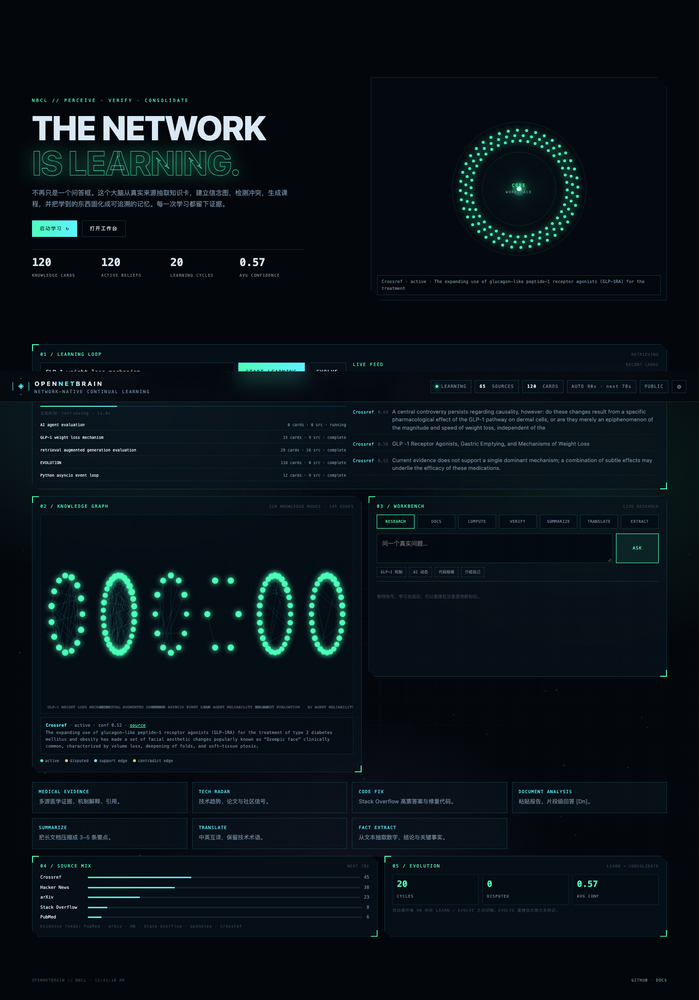

# OpenNetBrain（网络大脑）

> A network-native continual learner. It learns from real sources, builds knowledge cards and a belief graph, verifies evidence, and improves from community feedback.
>
> 一个持续学习的网络大脑：从真实来源抽取知识卡，建立信念图，检测冲突，自动学习/进化，并根据使用者意见改进。

[](https://github.com/zacrisy/open-net-agent/actions)
[](https://zacrisy.github.io/open-net-agent/brain.html?v=19)
[](LICENSE)
[](https://www.python.org/)



## Live

- **Brain console**: <https://zacrisy.github.io/open-net-agent/brain.html?v=19>
- **Feedback window**: 控制台右上角 **✎ 提意见**，或 <https://zacrisy.github.io/open-net-agent/brain.html?v=19&feedback=1>
- **Landing**: <https://zacrisy.github.io/open-net-agent/>
- **GitHub**: <https://github.com/zacrisy/open-net-agent>
- **Release v0.8.0**: <https://github.com/zacrisy/open-net-agent/releases/tag/v0.8.0>
- **Roadmap discussion**: <https://github.com/zacrisy/open-net-agent/discussions/9>
- **Feedback issue**: <https://github.com/zacrisy/open-net-agent/issues/8>
- **Full API (domestic VPS)**: <https://kids-pcs-attacked-myth.trycloudflare.com>
- **Cloud mode**: GitHub Actions runs learning/evolution every 5 minutes and publishes `docs/cloud_brain.json`; Pages automatically uses this snapshot when the local API is offline, with browser-side OpenAlex/Crossref research.
- **Cloud feedback**: feedback opened as a GitHub issue labeled `feedback` is imported by `cloud_feedback.yml` into the cloud brain DB.

## What it does

### 1. Continual learning loop

```
RETRIEVE → EXTRACT → VERIFY → CONSOLIDATE → EVOLVE
```

- 真实来源：PubMed / arXiv / Hacker News / Stack Overflow / OpenAlex / Crossref；
- 每轮抽取**知识卡**：claim、evidence、source、confidence、status；
- 建立**信念图**：supports / contradicts / disputed；
- 去重、重建图、更新边；
- **本地模式**：AUTO 每 **20 秒**在 LEARN / EVOLVE 之间切换（依赖协调者进程常驻）。
- **云端模式**：GitHub Actions 每 **5 分钟**跑最多 **10 轮**学习/进化，结果发布为 Pages 快照。

> 这里的“学习”是知识卡、信念图和课程层的学习，不是全局权重反向传播。物理限制与实验见 [`nbpw/DESIGN.md`](nbpw/DESIGN.md)。

### 2. Interactive knowledge graph

- 首屏大脑图和下方 Knowledge Graph 都可点击；
- 点击节点打开知识卡弹窗：来源、置信度、完整 claim、源链接；
- `disputed` 卡用琥珀色标记；
- **Typed graph + PPR**：IDF 种子 → Personalized PageRank → 一跳扩展；research 会追加“关联知识卡（图谱扩散）”；
- 评估诊断：[`nbpw/GRAPH_RETRIEVAL.md`](nbpw/GRAPH_RETRIEVAL.md)（合成小样本，尚无显著优势）；
- 冲突/引用/保留验证：[`nbpw/VERIFICATION.md`](nbpw/VERIFICATION.md)；
- 记忆生命周期/workspace：[`nbpw/MEMORY_WORKSPACE.md`](nbpw/MEMORY_WORKSPACE.md)。

### 3. MISSION CONTROL（Level-2 研究智能体）

- 目标：问题 + 预算；
- 闭环：`goal → predict → act → observe → compare → reflect → synthesize`；
- 动作：search / graph / verify / synthesize / abstain；
- 每一步记录预测、观察、surprise、反思；
- 技能使用统计、评分、引用检查；
- 文档：[`nbpw/AGENT.md`](nbpw/AGENT.md)；
- 抽象测试：[`nbpw/ARC.md`](nbpw/ARC.md)（12 个玩具任务，12/12；不是 ARC-AGI）；
- 元认知/课程：[`nbpw/METACOGNITION.md`](nbpw/METACOGNITION.md)。

### 4. Workbench

| Tool | Function |
|---|---|
| RESEARCH | 多源研究 + `[n]` 引用 |
| DOCS | 文档片段级 `[Dn]` 问答 |
| COMPUTE | AST 安全计算 |
| VERIFY | 词面/否定核查（SUPPORTS / REFUTES / UNCERTAIN） |
| SUMMARIZE | 抽取式摘要 |
| TRANSLATE | 中英互译 |
| EXTRACT | 数字/结论/关键事实抽取 |

### 5. Community feedback → self-improvement

- 用户在 **✎ 提意见** 窗口提交意见；
- 大脑自动分类：`bug / feature / knowledge / style / other`；
- **知识类意见**进入 AUTO 学习队列，下一轮自动学习该主题；
- 其他意见生成**可审计的改进提案**，显示在 `SELF-IMPROVEMENT` 面板；
- 公开意见不会直接改代码；提案需要维护者审查。

API:

```bash
POST /api/brain/feedback       {"text":"...","kind":"knowledge","contact":""}
GET  /api/brain/feedback       recent public feedback
GET  /api/brain/improvements   improvement proposals
```

## Why this design

- **证据优先**：没有来源就明说，不编造；
- **可追溯**：每张卡有来源、置信度、状态；
- **可进化**：AUTO 学习 + EVOLVE 重建图 + 意见驱动课程；
- **可审计**：冲突不删除，标记 `disputed`；
- **网络原生**：节点只做 source / verifier / memory / expert，不要求人人有模型。

## Quick start

```bash
cd network_agent
python3 -m venv .venv && . .venv/bin/activate
pip install aiohttp
python3 run_online.py
# open http://127.0.0.1:8080/

# optional, recommended: external heartbeat for continuous AUTO learning
python3 auto_beat.py --interval 15
```

实验复现：

```bash
cd nbpw
pip install -r requirements.txt
python3 run_experiments.py      # routing / predictive coding / workspace
python3 run_continual.py        # knowledge cards / belief revision / pruning
```

实验报告：

- [`nbpw/REPORT.md`](nbpw/REPORT.md)
- [`nbpw/REPORT_CONTINUAL.md`](nbpw/REPORT_CONTINUAL.md)

## Architecture

```
brain.html ── CORS ──> coordinator_async.py
                         ├─ /api/brain/status, /graph, /learn, /evolve
                         ├─ /api/brain/feedback, /improvements
                         ├─ /public/ask (research/docs/compute/verify/summarize/translate/extract)
                         └─ /public/status
                              │
                              ▼
                         brain.py  (NBCL)
                         ├─ agent_core.collect — real sources
                         ├─ continual.extract_cards / dedup / build_belief
                         └─ SQLite: cycles / cards / edges / feedback / improvements
```

## Public hosting caveat

- UI 托管在 GitHub Pages，公开可访问；
- **云端学习**不依赖本机：GitHub Actions 每 5 分钟运行，Pages 读取 `cloud_brain.json`；
- **完整问答/20 秒节奏**仍通过 **Cloudflare Quick Tunnel + serveo fallback** 跑在维护者机器上；
- **不是 24/7 云服务**：机器休眠/断网/隧道重启会暂停问答与 AUTO；
- 生产部署见 [`deploy/PUBLIC.md`](deploy/PUBLIC.md)。

## Intelligence roadmap

Why the current system is a memory/knowledge system rather than an intelligent agent, and the path to goals, world models, action, abstraction, metacognition, and evaluation:

- [`docs/INTELLIGENCE_ROADMAP.md`](docs/INTELLIGENCE_ROADMAP.md)

## Research review

Full evaluation of the project against the original NBPW/NBCL thesis, literature review (2024–2026), maturity scorecard, and a 90-day roadmap:

- [`docs/RESEARCH_REVIEW.md`](docs/RESEARCH_REVIEW.md)
- Local source: `../网络大脑项目全面评估与改进研究.md`

## Deploy full API 24/7 (domestic VPS recommended)

Hugging Face is not reliably reachable from mainland China. For a domestic 24/7 API, use an Aliyun/Tencent/Huawei lightweight Ubuntu server (requires your real-name account):

See [`deploy/DOMESTIC.md`](deploy/DOMESTIC.md). The root `Dockerfile` runs the full coordinator + `BRAIN_AUTO=1` 20s heartbeat.

## Alternative: Hugging Face Space

GitHub Actions runs learning, but cannot serve a persistent HTTP API. For a 24/7 full API:

1. Create a free Hugging Face account and a **write** token: <https://huggingface.co/settings/tokens>
2. Run:

```bash
cd network_agent
HF_TOKEN=hf_xxx bash deploy/hf_space.sh
```

The Space builds the root `Dockerfile`, serves the full API + `brain.html`, and runs `BRAIN_AUTO=1` inside the container.

See [`deploy/HF_SPACE.md`](deploy/HF_SPACE.md).

## Limitations (honest)

- Verify 是词面/否定启发式，不是完整 NLI；
- 图谱支持边是语义启发式，不是严格事实；
- 概念问答实验约 0.67，仍需多卡综合；
- 真实外部节点仍为 0，当前是本机演示节点；
- 反馈驱动的自动改进目前限于**学习主题 + 提案**，不会自动改代码。

## Contributing

- 提意见：控制台 **✎ 提意见**；
- 提 Issue / PR：<https://github.com/zacrisy/open-net-agent/issues>
- 设计讨论：`nbpw/DESIGN.md`

## License

MIT
