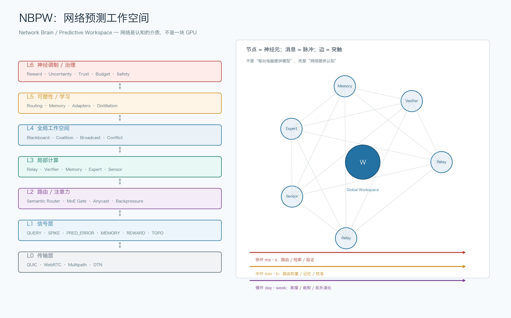
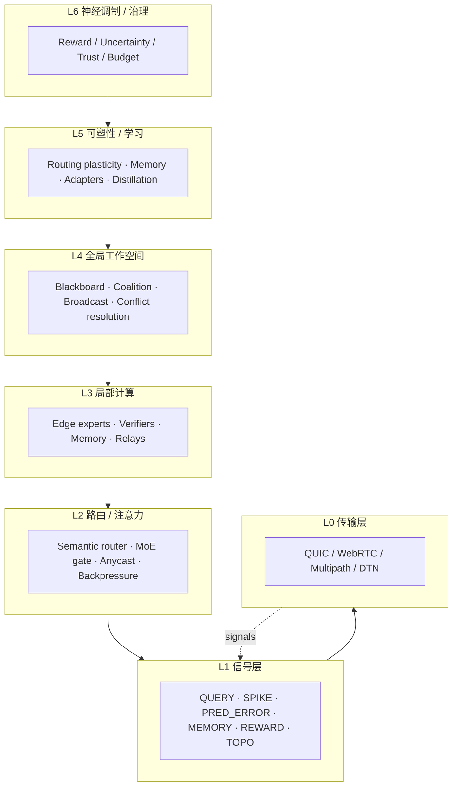

# 网络大脑：从“节点联邦”到“网络预测工作空间”（NBPW）

**版本**：v0.1 设计稿  
**日期**：2026-11-04  
**一句话**：不要让每台电脑“提供模型/资源/token”，而让网络本身成为一个**事件驱动、预测编码、全局工作空间**的认知系统；学习发生在**路由、记忆、局部适配器与蒸馏**上，而不是把互联网当成一块 GPU 做全局反向传播。

---

## 0. 结论先行

1. **字面意义的“用网络传输训练一个大模型”不可行**：WAN 的 RTT、带宽、丢包、异构、同步屏障，决定了全局反向传播在互联网尺度上不成立。网络传的是信号，计算仍发生在端点或可编程网络设备上。
2. **但“网络大脑”作为一套架构是成立的**：把节点当神经元、消息当脉冲、路由当突触、全局工作空间当意识广播、预测误差当主要信号；学习的是**连接/路由/记忆/局部适配器**，不是全网权重。
3. **推荐落地形态**：NBPW = **预测编码 + 全局工作空间 + 语义路由 + 局部可塑性 + 联邦蒸馏**。分三层：WAN 做推理/路由/记忆，LAN/Edge 做稀疏激活交换与局部学习，可编程网络做 in-network 聚合（研究层）。
4. **对 OpenNetAgent 的改造**：不再要求每个节点“有模型/有 token”；节点可以只做**中继、验证、记忆、局部专家**，按能力画像参与。协调者从“任务路由器”升级为“工作空间/神经调制器”。

---

## 1. 旧方案为什么走不通

当前 OpenNetAgent 的模式是：

```
client → coordinator → 节点（本地记忆/模型/技能）→ 聚合
```

它有三个结构性瓶颈：

| 瓶颈 | 表现 |
|---|---|
| **授权与 token** | 每台机器要申请 token、配置模型、保持在线；加入门槛高 |
| **资源异构** | 有的机器有 GPU，有的只有 CPU，有的在 NAT 后；能力参差 |
| **质量不可控** | 节点可能返回错误、过期、恶意结果；验证成本高 |
| **协调者中心化** | 路由、聚合、验证都压在协调者；规模上去后成为瓶颈 |
| **“节点=小模型”假设** | 大部分电脑并没有可用的本地模型，也没有动力长期贡献 |

更根本的问题是：**我们把“网络”当成了“机群的替代品”，而不是“认知的介质”。**

---

## 2. 物理边界：为什么不能把互联网当 GPU

### 2.1 三个硬约束

| 约束 | 数量级 | 后果 |
|---|---|---|
| **RTT** | 同城 1–10ms；跨洲 80–250ms；移动网络 30–100ms | 无法做逐层同步；大脑的 spike 时间尺度是 1–10ms |
| **带宽** | 家庭上行 10–100Mbps；跨洲链路共享 | 传梯度/激活比传数据贵几个数量级 |
| **丢包/抖动/异构** | 1–5% 丢包常见；设备性能差 10–100× | 同步屏障会被最慢节点拖死；staleness 不可控 |

### 2.2 一个具体算例

假设一个 1B 参数模型，FP16：

- 梯度 all-reduce：约 **2GB/step**；
- 100Mbps 上行：约 **160 秒/step**，还不含重传/拥塞；
- 训练需要 10⁴–10⁶ step：**数月到数年**，且任何节点掉线都会拖慢。

推理也不轻松：

- hidden=2048，batch=32，FP16 激活约 131KB/层；32 层约 4MB/forward；
- 跨 WAN 逐层流水：每 token 至少多 1 个 RTT + 传输；交互式体验不可接受。

**结论**：全局反向传播、逐层同步、跨洲张量并行，在互联网尺度上不成立。任何声称“用网络本身训练大模型”的方案，必须回答“计算在哪里、梯度怎么同步、延迟预算多少”。

---

## 3. 重新定义“网络大脑”

### 3.1 它不是“一个模型”，而是一个图动力系统

把网络定义为：

```
G = (V, E)
h_v(t)   : 节点 v 的状态（记忆、局部适配器、置信度、负载、能力画像）
m_uv(t)  : 边上的消息（查询、脉冲、预测误差、记忆、奖励、拓扑）
W(t)     : 全局工作空间（当前被广播/竞争的活跃 coalition）
```

更新：

```
h_v(t+1) = Update_v( h_v(t), Aggregate_{u∈N(v)} M(h_u(t), h_v(t), e_uv) )
W(t+1)   = Workspace( {h_v(t+1)} )
```

这不是一个巨大的 Transformer，而是一个**消息传递图网络 + 动态路由 + 全局广播**。

### 3.2 三个时间尺度

| 环路 | 时间 | 做什么 | 学什么 |
|---|---|---|---|
| **快环** | ms–s | 信号路由、检索、验证、聚合 | 不学习，只推理 |
| **中环** | 分钟–小时 | 路由权重、记忆写入、置信度校准 | 连接/路由/记忆 |
| **慢环** | 天–周 | 蒸馏、裁剪、拓扑演化、适配器合并 | 全局先验/专家 |

### 3.3 与“联邦学习”的区别

| | 联邦学习 | NBPW |
|---|---|---|
| 目标 | 训练一个全局模型 | 维持一个可工作的认知网络 |
| 传输 | 梯度/模型更新 | 脉冲/预测误差/记忆/路由信号 |
| 同步 | 轮次同步 | 异步、逻辑时钟、staleness 容忍 |
| 学习 | 全局 SGD | 局部可塑性 + 路由学习 + 蒸馏 |
| 节点要求 | 有数据、有算力 | 可只做中继/验证/记忆 |

---

## 4. 神经科学映射

| 生物概念 | 网络实现 | 说明 |
|---|---|---|
| 神经元 | 节点/边缘专家/验证器 | 不一定有“模型”，可以是纯中继 |
| 突触 | 链路 + 路由权重 + 延迟 | 权重=信任/成功率/语义匹配 |
| 动作电位 | 稀疏事件消息 | 只在“惊讶度”超过阈值时发送 |
| 树突整合 | 边缘聚合/可编程交换机 | in-network aggregation |
| 皮层柱 | 区域子网/专家簇 | 按语义/地域/能力聚类 |
| 突触可塑性 | 路由更新/局部适配器 | Hebbian、reward-modulated |
| 神经调制 | 奖励/不确定性/信任广播 | 多巴胺/血清素类比 |
| 振荡 | 逻辑 epoch/相位 | 不要求墙钟同步 |
| 睡眠巩固 | 周期蒸馏/压缩/重放 | 把经验固化进先验 |
| 注意力 | 路由/门控/工作空间竞争 | 谁被广播、谁被抑制 |
| 预测编码 | 只传预测误差 | 带宽大幅下降 |

---

## 5. 核心原则

1. **事件驱动稀疏**：不是每个 token 都广播；只有预测误差/高置信事件才发。
2. **预测编码**：每个节点先预测，再发残差 `r = x - x̂`；`||r|| < θ` 不发。
3. **全局工作空间**：不是所有节点都参与；活跃 coalition 竞争广播，形成“当前思维”。
4. **局部可塑性**：不做全局反向传播；用 Hebbian/奖励调制/bandit 更新路由。
5. **通信预算**：节点提供的是**带宽/时延/存储/验证**预算，而不是统一的 token。
6. **能力画像**：每个节点声明 `skills, latency, bandwidth, privacy, reliability`，路由按画像匹配。
7. **异步与 staleness**：逻辑时钟 +  staleness 上限；不要求全局 barrier。
8. **可验证**：消息签名、来源信誉、quorum、可审计。
9. **隐私**：只传摘要/残差/蒸馏信号；原始数据不出节点。
10. **优雅降级**：节点掉线时，工作空间缩小、精度下降，但不崩。

---

## 6. 分层架构（NBPW）





### L0 传输层

- QUIC/WebRTC 优先：0-RTT、多路复用、可插拔拥塞控制；
- 多路径：Wi-Fi/5G/有线并行；
- DTN（延迟容忍网络）：断连时存储转发；
- 任何cast：把查询送到“语义最近”的节点，而非固定 IP。

### L1 信号层

统一消息信封：

```json
{
  "id": "uuid",
  "parent": "uuid|null",
  "type": "QUERY|SPIKE|PRED_ERROR|MEMORY|REWARD|TOPO|VOTE",
  "epoch": 123,
  "ttl": 8,
  "src": "node-id",
  "dst": "node-id|anycast:medical",
  "payload": {"sparse": [0.1, -0.2], "topk": [12, 88, 301]},
  "confidence": 0.72,
  "budget": {"bytes": 4096, "deadline_ms": 800},
  "sig": "ed25519:..."
}
```

- `SPIKE`：稀疏激活/事件；
- `PRED_ERROR`：预测残差；
- `MEMORY`：读/写/摘要；
- `REWARD`：任务成败/时延/成本；
- `TOPO`：邻居/能力/负载更新；
- `VOTE`：验证/quorum。

### L2 路由/注意力

- **语义路由**：query embedding → 最近专家/区域；
- **MoE gate**：`g = softmax(W·x)`，top-k 专家；
- **Anycast**：同一语义 key 的多个副本，选最近/最空闲；
- **Backpressure**：节点过载时广播“减速”，路由绕开；
- **学习**：contextual bandit / UCB / Thompson，奖励 = 成功 - 时延 - 成本。

### L3 局部计算

节点可以是：

| 类型 | 贡献 | 是否需要模型 |
|---|---|---|
| **Relay** | 转发、缓存、压缩 | 否 |
| **Verifier** | NLI/事实核查/签名 | 可选小模型 |
| **Memory** | 向量库/摘要/经验 | 否 |
| **Expert** | 小模型/适配器/工具 | 是（可选） |
| **Sensor** | 现实世界数据/API | 否 |

这就是“**不需要每台电脑都有模型**”的关键：节点按能力画像参与，不强制统一资源。

### L4 全局工作空间

- **Blackboard**：当前活跃的假设/证据/问题；
- **Coalition**：为当前任务临时组队的节点集合；
- **Broadcast**：只有胜出的 coalition 进入全局广播；
- **Conflict resolution**：冲突证据投票/验证器裁决；
- **Capacity**：工作空间有容量上限（类似注意瓶颈），防止全网噪声。

### L5 可塑性/学习

- 路由权重（连接强度）；
- 记忆（ episodic/semantic）；
- 局部适配器（LoRA/小分类器）；
- 全局 shadow model（蒸馏）；
- 拓扑（增删边/区域）。

### L6 神经调制/治理

- Reward：任务成功、用户反馈；
- Uncertainty：置信度/熵；
- Trust：信誉/签名/历史；
- Budget：带宽/时延/能量；
- Safety：限流、审计、kill switch。

---

## 7. 协议设计细节

### 7.1 信号压缩

| 方法 | 用途 | 压缩比 |
|---|---|---|
| top-k 稀疏 | 激活/专家输出 | 10–100× |
| 量化（int8/4bit） | 嵌入/梯度 | 2–8× |
| 预测残差 | 时序信号 | 5–50× |
| Count-Min Sketch | 频率/路由统计 | 10–100× |
| 摘要/蒸馏 logits | 联邦蒸馏 | 100–1000× |

### 7.2 同步

- **逻辑时钟**（Lamport/vector clock）标记因果；
- **epoch** 只用于软同步，不强制全局 barrier；
- **staleness bound**：超过 S 个 epoch 的更新丢弃；
- **异步聚合**：先到先算，后到修正。

### 7.3 安全

- 消息 Ed25519 签名；
- nonce/时间戳防重放；
- 节点信誉（成功/失败/延迟/投诉）；
- Sybil 成本：加入需 proof-of-work/押金/邀请/信誉；
- 隐私：DP 噪声、—联邦蒸馏不传原始数据；
- 审计：关键消息落盘，可回溯。

---

## 8. 学习机制（核心）

### 8.1 路由学习（最快见效）

```
state s = (query embedding, load, latency, trust)
action a = 选择专家/路径
reward r = task_success - λ·latency - μ·bytes - ν·cost
```

- 用 contextual bandit / UCB / Thompson；
- 每个节点维护 `(success, fail, latency)`，工作空间做全局先验；
- 这是“网络越用越聪明”的最现实路径。

### 8.2 局部适配器（边缘学习）

- 节点在本地数据上训练小 adapter（LoRA/线性头）；
- 只上传 **adapter delta**（压缩/量化/DP）；
- 工作空间做 **adapter 合并/路由**；
- 不传原始数据、不传全模型。

### 8.3 联邦蒸馏（不需要节点有标签）

- 工作空间维护一个 **global shadow model**；
- 节点在**公共 probe set** 上输出 logits/embedding；
- 全局模型学 `KL(p_i || q)`；
- 只传 logits（小），不传数据/权重；
- 适合异构节点：手机/浏览器也能参与。

### 8.4 预测编码 / 世界模型

- 每个节点预测下一个信号/查询/结果；
- 只发残差 `r = x - x̂`，`||r|| > θ` 才发；
- 全局 world model 学 `p(s_{t+1}|s_t,a_t)`；
- 这就是“神经信号”的工程版本：**传惊讶，不传原始数据**。

### 8.5 Hebbian / STDP 路由

- 共同激活的边增强：`w_uv += η·x_u·x_v`；
- 奖励调制：`Δw = η·r·x_u·x_v`；
- 衰减/归一化防止爆炸；
- 不需要全局梯度，适合异步网络。

### 8.6 进化/拓扑

- 变异路由策略/拓扑；
- 选择任务成功率/时延/鲁棒性；
- 保留多样性（novelty search）；
- 慢环执行，不影响快环。

### 8.7 睡眠/巩固

- 周期性地：重放高价值经验、蒸馏、裁剪、量化、合并；
- 把“快环经验”固化到“慢环先验”；
- 对应生物睡眠中的记忆巩固。

---

## 9. 三种可行模式（务实分层）

| 模式 | 网络角色 | 学习什么 | 延迟 | 可行性 |
|---|---|---|---|---|
| **A. Inference Network** | 路由到现有专家/模型/API | 路由、记忆、校准 | 100ms–2s | ✅ 现在 |
| **B. Federated Distillation** | 边缘 adapter + 全局 shadow | adapter、蒸馏、DP | 分钟级 | ✅ 近期 |
| **C. Spiking LAN Cluster** | 稀疏脉冲 + in-network 聚合 | 局部可塑性、世界模型 | 1–20ms | 🔬 LAN/研究 |
| **D. Global WAN Backprop** | 全网张量并行 | 全局权重 | 不可行 | ❌ |

**推荐路线**：先做 A，再做 B；C 作为 LAN 实验；不要承诺 D。

---

## 10. 理论支撑与公式

### 10.1 图消息传递

```
h_v^{t+1} = Update( h_v^t, Agg_{u∈N(v)} M(h_u^t, h_v^t, e_uv) )
```

网络就是一张动态图；路由=边权；工作空间=图上的广播子图。

### 10.2 预测编码

```
L = ||x - x̂||² + β·KL(q(z|x) || p(z))
r = x - x̂
send(r) if ||r|| > θ
```

只传“惊讶”，大幅降低带宽；与自由能原理一致。

### 10.3 路由目标

```
J(π) = E[ task_success ] - λ·E[latency] - μ·E[bytes] - ν·E[energy]
```

用 bandit/policy gradient 学习；不需要全局反向传播。

### 10.4 联邦蒸馏

```
L_global = E_{x~probe}[ KL( p_i(y|x) || q(y|x) ) ]
```

节点只传 logits；全局模型学共识；DP 噪声保护隐私。

### 10.5 通信下界

任何分布式训练每步至少需要传输 `Ω(model_size)` 的信息（参数/梯度/更新）；在带宽 B、延迟 L 下，step time ≥ `model_size/B + L`。这是物理下界，算法无法绕过，只能压缩/异步/局部化。

### 10.6 储层计算

固定网络动力学 + 只训练 readout：`y = W_out·h(t)`；适合“网络本身是随机/固定动力学，学习只在输出层”的轻量方案。

---

## 11. 与 OpenNetAgent 的衔接

| 现有 | NBPW 改造 |
|---|---|
| coordinator 路由任务 | **工作空间 + 神经调制器** |
| node 提供 retrieval/echo/NLI | 节点增加 **relay/verifier/memory/expert** 画像 |
| 每节点 token | **带宽/时延/信誉预算**；token 只用于管理，不用于强制算力 |
| `/ask` 研究 | 变成工作空间的一个 **skill coalition** |
| 经验库/知识包 | **慢环记忆**；继续保留 |
| 中央聚合 | 逐步引入 **anycast + 局部聚合 + quorum** |

### 迁移阶段

1. **Phase 0（1–2 周）**：消息信封 + 能力画像 + 语义路由；不改模型。
2. **Phase 1（3–4 周）**：工作空间 blackboard + coalition + 路由 bandit；A 模式。
3. **Phase 2（4–6 周）**：预测残差 + 记忆巩固 + 联邦蒸馏；B 模式。
4. **Phase 3（研究）**：LAN 稀疏脉冲 + in-network 聚合；C 模式。

---

## 12. MVP 实验设计

### 12.1 LAN 5–10 节点

- 5 台 Mac/mini PC + 1 个协调者；
- 注入 10–50ms 延迟、1–5% 丢包；
- 任务：研究问答、文档检索、NLI、路由选择；
- 记录：p50/p95、bytes/query、成功率、staleness。

### 12.2 对照

| 基线 | 说明 |
|---|---|
| Centralized | 单机模型/检索 |
| Current coordinator | 现有 OpenNetAgent |
| Random routing | 随机选节点 |
| MoE gate | 学习门控 |
| NBPW | 工作空间 + 预测残差 + bandit |

### 12.3 消融

- 有无预测编码（带宽/精度）；
- 事件阈值 θ；
- 工作空间容量；
- 压缩比；
- staleness 上限；
- 节点掉线比例。

### 12.4 成功标准

- 任务成功率 ≥ 基线；
- p95 延迟 ≤ 2× 基线；
- bytes/query 下降 ≥ 50%；
- 20% 节点掉线仍可降级运行；
- 路由学习曲线在 100 次查询内可见提升。

---

## 13. 评估指标

| 维度 | 指标 |
|---|---|
| 任务 | accuracy / answer quality / citation correctness |
| 时延 | p50 / p95 / tail |
| 带宽 | bytes per query / per token |
| 计算 | communication/computation ratio |
| 鲁棒 | 掉线/丢包/攻击下的性能 |
| 学习 | 路由 regret / 蒸馏增益 / 遗忘 |
| 隐私 | DP ε / 原始数据出域比例 |
| 治理 | sybil 成本 / 审计覆盖率 |

---

## 14. 风险与治理

- **未经同意使用设备**：必须显式 opt-in、能力画像、预算、随时退出；
- **网络滥用/放大攻击**：签名、限流、TTL、审计；
- **隐私**：不传原始数据；DP；联邦蒸馏；
- **中心化**：工作空间可能变成新瓶颈；多工作空间/分片；
- **安全**：恶意节点、投毒、女巫；信誉 + 押金 + 验证；
- **能源**：路由/传输也有成本；预算与碳指标；
- **责任**：谁对网络大脑的输出负责？需要审计与可解释。

---

## 15. 结论

**“网络大脑”不是“把互联网当 GPU”，而是“把网络当成认知的介质”。**

- 物理上：全局 WAN 反向传播不可行；不要承诺。
- 理论上：图消息传递 + 预测编码 + 全局工作空间 + 局部可塑性 + 联邦蒸馏，是一套自洽且可实现的框架。
- 工程上：先做 **A 模式（推理网络 + 路由/记忆学习）**，再做 **B 模式（边缘 adapter + 蒸馏）**，C 模式留给 LAN/研究。
- 产品上：节点不再需要“有模型/有 token”；可以只做中继、验证、记忆、传感器；按能力画像参与。

**NBPW 的核心创新点**：

1. **从“节点提供模型”转为“网络提供认知”**；
2. **从“传数据/梯度”转为“传预测误差/脉冲”**；
3. **从“全局同步训练”转为“路由/记忆/适配器的多尺度可塑性”**；
4. **从“中心协调者”转为“全局工作空间 + 神经调制”**。

这条路不承诺“马上出现超级智能”，但它是一条**物理上诚实、工程上可落地、理论上可解释**的网络智能路线。

---

## 16. 初步实验结果（v0.1）

30 节点仿真、800 查询、5 seed、20% 中途掉线：

- **路由**：NBPW k=3 成功率 0.947，UCB 0.805；p99 0.057s vs 1.0s；代价是 2.7× 带宽。
- **k 的性价比**：k=2（0.909 / 8.11B）是预算甜点；k=3（0.947 / 11.6B）适合尾延迟；k=5 边际收益下降。
- **预测编码**：θ=1.8 时 2.8B/step、MSE 0.112（22.9× 压缩）；θ=1.2 时 49.3B、MSE 0.016。它是预算旋钮，不是无损压缩。
- **错误相关性是上限**：独立错误 k=11 到 0.963；相关性 0.2 时 k=5（0.825）反而低于 k=3（0.830）。**多样性 > 数量**。

实验报告：[REPORT.md](<REPORT.md>)  
代码：`network_agent/nbpw/`

**修订**：workspace 默认 k=2（预算敏感）或 k=3（尾敏感）；增加错误相关性惩罚；预测编码阈值按任务设；不再假设“多接同质节点会更聪明”。

## 参考文献

- [Distributed Machine Learning Systems: Algorithms, Communication Efficiency, and Convergence Guarantees](https://zenodo.org/records/19486564)
- [The principles of adaptation in organisms and machines: machine learning, information theory, and thermodynamics](https://ar5iv.labs.arxiv.org/html/1902.11233)
- [The Evolution of Mixture-of-Experts Architectures in LLMs: Routing, Topology, Load Balancing, Expert Parallelism](https://browse-export.arxiv.org/abs/2608.08650)
- [ACM CoNEXT Workshop on In-Network Computing and AI for Distributed Systems](https://dl.acm.org/doi/proceedings/10.1145/3769699)
- [A Predictive Global Neuronal Workspace for a Continuously Running Synthetic Mind](https://zenodo.org/records/21288924)
- [Neuromorphic architectures for edge-oriented spiking neural networks: a review](https://www.sciencedirect.com/science/article/pii/S1383762126001876)
- [Reservoir Computing perspective: dynamics, neuroscience, and physical systems](https://zenodo.org/records/22178685)
- [Lower Bounds and Optimal Algorithms for Personalized Federated Learning](https://proceedings.nips.cc/paper_files/paper/2020/file/187acf7982f3c169b3075132380986e4-Paper.pdf)
- [World model learning and inference](https://www.sciencedirect.com/science/article/pii/S0893608021003610)
