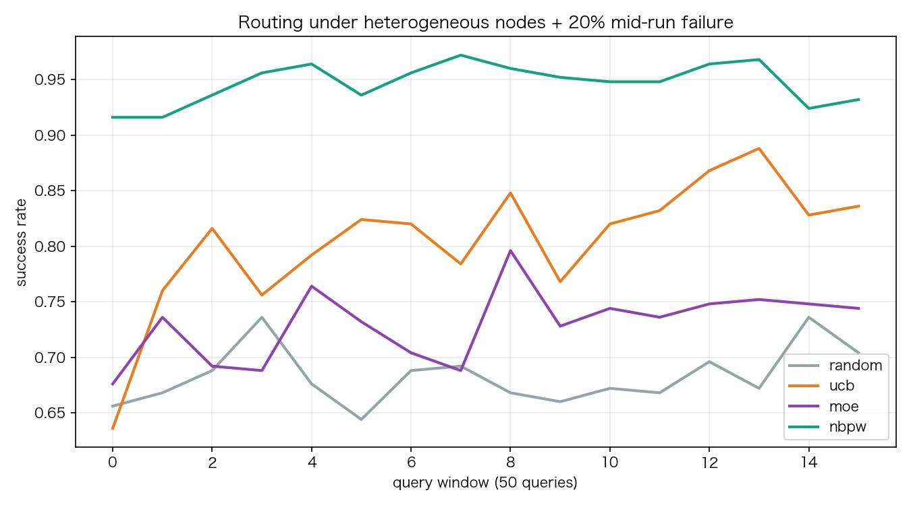
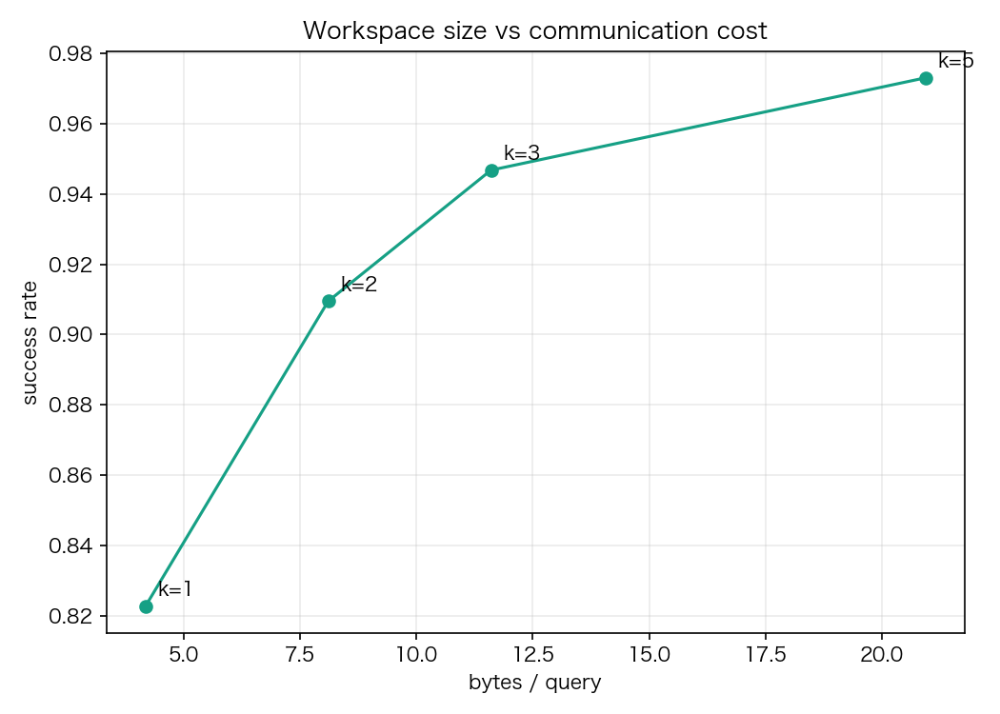
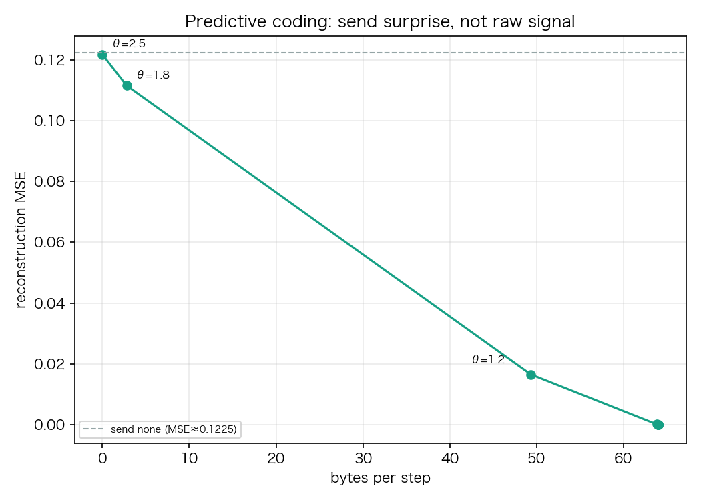
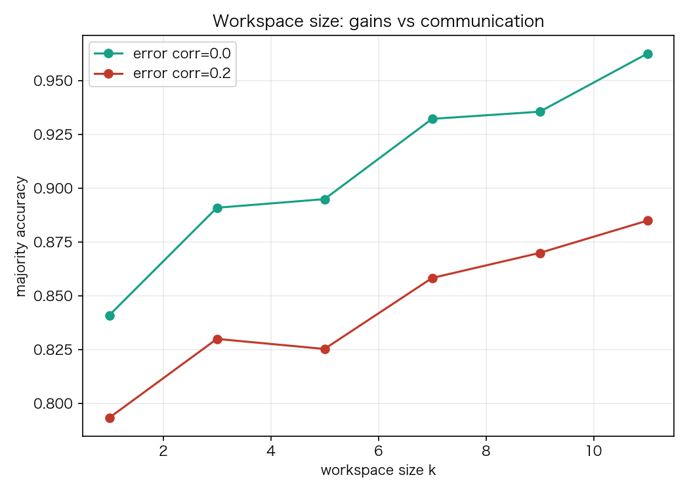

# 网络大脑初步实验：路由、预测编码与工作空间

**日期**：2026-11-04  
**代码**：`network_agent/nbpw/`  
**复现**：

```bash
cd network_agent/nbpw
python3 run_experiments.py
```

结果：`results.json`；图：`figs/*.png`。

---

## 0. 摘要

这轮实验只验证 NBPW 的三个可落地机制，不验证“全网反向传播”：

1. **异构节点上的能力路由**（random / UCB / MoE / NBPW workspace）；
2. **预测编码**：只传预测残差，能换回多少带宽；
3. **工作空间规模**：多节点投票的收益、成本与错误相关性。

结论先行：

- NBPW（top-3 workspace）把成功率从 UCB 的 **0.805** 提升到 **0.947**，p99 延迟从 **1.0s** 降到 **0.057s**；代价是 **2.7× 带宽**（11.6 vs 4.25 bytes/query）。
- 这不是“免费变强”：按 success/byte 算，MoE 最省（0.345），UCB 0.189，NBPW 0.082。**k 必须按预算自适应**。
- 预测编码是**预算旋钮**，不是免费压缩：θ=1.8 时带宽降到 2.8B/step（22.9×），但 MSE 从 0 升到 0.112；θ=1.2 时 49.3B、MSE 0.016。
- **错误相关性是 workspace 的上限**：独立错误时 k=11 可到 0.963；相关性 0.2 时 k=5 反而低于 k=3（0.825 vs 0.830），k=11 也只有 0.885。**多样性 > 数量**。

---

## 1. 实验设置

### 1.1 异构节点

- 30 个模拟节点；
- 技能：retrieval / nli / web，每个节点 1–3 个；
- 质量 `q ~ U(0.55, 0.95)`；
- 延迟 `lognormal(~27ms)`；
- 通信成本 `1–8 bytes/query`；
- 可靠性 `0.85–0.99`；
- 800 次查询，5 个 seed；
- 在第 400 次查询时随机杀掉 **20%** 节点。

### 1.2 路由策略

| 策略 | 规则 |
|---|---|
| random | 随机选一个可用节点 |
| ucb | `qhat + 0.35*sqrt(log t / n)` |
| moe | `qhat - 0.35*latency - 0.01*cost`，top-1 |
| nbpw | 能力+探索−延迟−成本，top-k；加权多数投票；k=3 |

### 1.3 重要限制

- 这是**仿真**，不是真实 WAN；
- 质量/延迟/错误模型是合成的；没有真实模型错误相关性；
- 没有异步 staleness、没有安全/投毒；
- 预测编码用的是 AR(1) 合成信号，不是真实激活/嵌入。

因此，下面结论应作为**方向性证据**，不是最终产品指标。

---

## 2. E1：异构路由与掉线



| 策略 | 成功率 | p50 | p95 | p99 | bytes/query | success/byte |
|---|---:|---:|---:|---:|---:|---:|
| random | 0.683 | 0.028 | 1.000 | 1.000 | 4.30 | 0.159 |
| ucb | 0.805 | 0.035 | 0.810 | 1.000 | 4.25 | 0.189 |
| moe | 0.730 | 0.025 | 0.805 | 1.000 | 2.11 | **0.345** |
| **nbpw k=3** | **0.947** | 0.050 | **0.053** | **0.057** | 11.60 | 0.082 |

### 2.1 观察

- NBPW 的成功率最高，尾延迟最低；因为它并行查 3 个高质量/低延迟节点，再用加权多数投票。
- UCB/MoE 的 p99 仍是 **1.0s**：一旦选到慢节点/掉线节点，没有冗余兜底。
- NBPW 的代价是 **2.7× 带宽**；按每字节成功率算，反而不如 MoE/UCB。

### 2.2 workspace k 的性价比



| k | 成功率 | bytes/query | success/byte |
|---:|---:|---:|---:|
| 1 | 0.823 | 4.19 | 0.196 |
| 2 | 0.909 | 8.11 | 0.112 |
| 3 | 0.947 | 11.60 | 0.082 |
| 5 | 0.973 | 20.93 | 0.047 |

- **k=2 是预算敏感场景的甜点**：成功率 +0.086（相对 k=1），带宽只 1.9×；
- **k=3 是尾延迟/可靠性优先场景的甜点**：p99 从 1.0s 降到 0.057s；
- k=5 的边际收益明显变小（+0.026 成功率，+80% 带宽）。

### 2.3 掉线韧性

第 400 次查询杀掉 20% 节点：

| 策略 | 掉线前 | 掉线后 |
|---|---:|---:|
| random | 0.681 | 0.684 |
| ucb | 0.773 | 0.836 |
| moe | 0.710 | 0.749 |
| nbpw k=3 | 0.944 | 0.950 |

- UCB 在掉线后继续学习，反而提升；
- NBPW 一直保持高位，因为 top-k 冗余和低延迟选择；
- random 基本不受影响，因为它本来就不依赖质量。

**结论**：workspace 冗余买的是**尾部可靠性**，不是“平均更聪明”。在预算允许时，k=2/3 值得；预算紧张时，UCB/MoE 更划算。

---

## 3. E2：预测编码



| θ | send rate | bytes/step | MSE |
|---:|---:|---:|---:|
| 0.01 | 100% | 64.0 | 0.000 |
| 0.1 | 100% | 64.0 | 0.000 |
| 0.25 | 100% | 64.0 | 0.000 |
| 0.5 | 100% | 64.0 | 0.000 |
| 0.8 | 99.7% | 63.8 | 0.000 |
| 1.2 | 77% | 49.3 | 0.016 |
| 1.8 | 4.4% | 2.8 | 0.112 |
| 2.5 | 0% | 0.0 | 0.122 |

- 发送全量：64B/step，MSE=0；
- θ=1.8：2.8B/step（**22.9× 压缩**），MSE=0.112；
- θ=1.2：49.3B/step，MSE=0.016；
- 不发送：0B，MSE=0.1225（仅比 θ=1.8 差 8.6%）。

### 3.1 解释

- 预测编码的有效性取决于**信号可预测性**：AR(1) ρ=0.92 时，残差很小；
- 对“需要精确重建”的任务，θ 必须很小，压缩收益有限；
- 对“事件检测/异常/路由”任务，θ 可以大，压缩收益显著；
- **θ 是任务级预算参数，不是固定常数**。

**结论**：预测编码适合“传惊讶、不传原始数据”的事件型信号；不要把它当成无损压缩。真实嵌入/激活的可预测性通常低于 AR(1)，收益会更小，需要实测。

---

## 4. E3：workspace 规模与错误相关性



| k | 独立错误 | 相关性 0.2 |
|---:|---:|---:|
| 1 | 0.841 | 0.793 |
| 3 | 0.891 | 0.830 |
| 5 | 0.895 | **0.825** |
| 7 | 0.932 | 0.858 |
| 9 | 0.936 | 0.870 |
| 11 | **0.963** | 0.885 |

### 4.1 关键发现

- 独立错误：k 越大越好，但边际递减（k=3→11 只 +0.072，带宽 3.7×）；
- 相关性 0.2：**k=5 反而低于 k=3**；k=11 也只有 0.885；
- **相关错误会破坏“孔多塞陪审团定理”的独立性假设**：多加同质节点，只是在重复同一个错误。

### 4.2 对 OpenNetAgent 的直接含义

当前演示的 3 个节点：

- `node-retrieval` 与 `node-echo` 不是同一技能；
- 如果为了某个技能加很多 retrieval 节点，但它们**共用同一语料/同一模型/同一检索器**，错误高度相关，workspace 扩大不会变聪明；
- 真正有效的是**异质来源/模型/验证器**：
  - 不同语料（PubMed / arXiv / HN / SO）；
  - 不同模型/提示；
  - 不同验证器（NLI / 规则 / 人工）；
  - 不同时间/地域的副本。

**这是本轮最重要的结论：workspace 的上限由“错误相关性”决定，不由节点数量决定。**

---

## 5. 对项目的完善（基于结果）

### 5.1 设计修改

1. **默认 workspace k=2，尾敏感场景 k=3**；k=5 只在极高可靠性需求时启用；
2. **增加多样性惩罚**：选择节点时不仅看 qhat/延迟，还要估计**错误相关性**（同源、同模型、同语料降权）；
3. **预测编码阈值按任务设**：精确重建 θ 小；事件/路由 θ 大；把 bytes 作为一等预算；
4. **路由策略按预算切换**：
   - 成本优先：MoE/UCB；
   - 可靠性/尾延迟优先：NBPW k=3；
   - 中间：NBPW k=2；
5. **节点能力画像**：relay / verifier / memory / expert / sensor，不再要求人人有模型/token；
6. **掉线自适应**：失败后重新估计 qhat，workspace 自动收缩/换节点。

### 5.2 代码

- `network_agent/nbpw/sim.py`：异构节点、路由策略、workspace、预测编码；
- `network_agent/nbpw/run_experiments.py`：E1/E2/E3 + 图；
- `network_agent/nbpw/results.json`：原始结果；
- 可复现：`python3 run_experiments.py`。

### 5.3 不能从这轮实验得出的结论

- 不能证明 NBPW 在真实 WAN 上更好；
- 不能证明预测编码在真实嵌入上同样有效；
- 不能证明 30 节点/800 查询能外推到互联网规模；
- 不能证明“网络大脑”已经实现——这只是路由/工作空间/预测编码三个机制的初步证据。

---

## 6. 下一轮实验（LAN 真机）

1. **5–10 台 LAN 节点**（Mac/mini PC），用 `netproxy` 注入 10–50ms 延迟、1–5% 丢包；
2. 真实技能：retrieval / NLI / web 摘要；真实查询集；
3. 测量**错误相关性**：同一问题下节点答案的一致率/相关矩阵；
4. 对比：centralized、current coordinator、random、UCB、MoE、NBPW k=2/3；
5. 指标：accuracy、p50/p95/p99、bytes/query、掉线 20% 降级、路由学习曲线；
6. 预测编码：用真实 embedding/激活，测 θ 的 Pareto；
7. 联邦蒸馏：小 adapter/logits 的通信-精度曲线。

---

## 7. 结论

- NBPW 的**路由 + workspace** 在仿真中能显著提升成功率和尾延迟，但代价是带宽；**k 必须按预算自适应**。
- 预测编码是**预算旋钮**，不是无损压缩；要对任务设 θ。
- **错误相关性是 workspace 的上限**：多样性比数量重要；这直接改变了“多接节点就会更聪明”的假设。
- 下一阶段的重点不是加更多同质节点，而是：
  1. 异质来源/模型/验证器；
  2. 相关性感知的 workspace；
  3. LAN 真机验证；
  4. 预算感知的路由。

一句话：**网络大脑的第一条实证规律是：冗余买可靠性，多样性买智能。**
