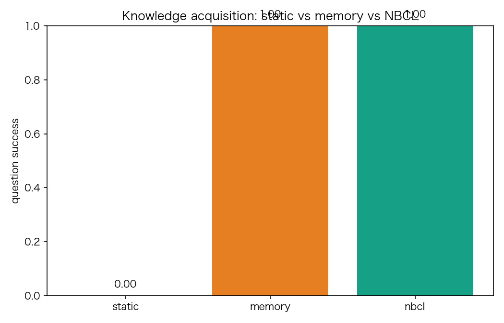
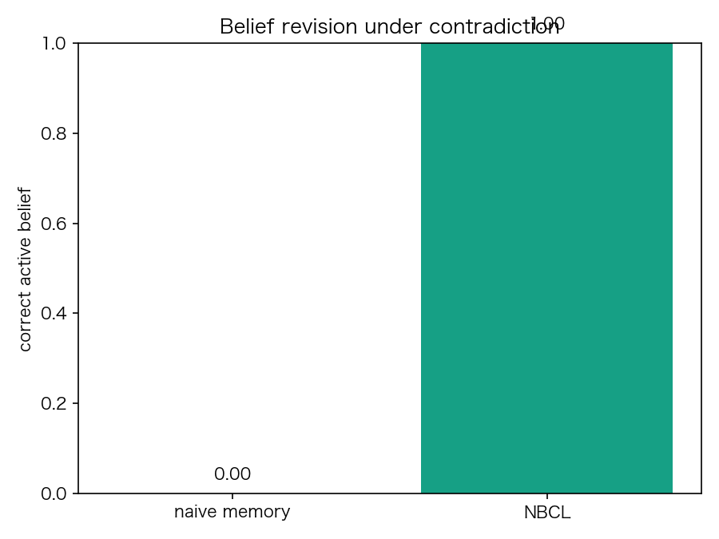
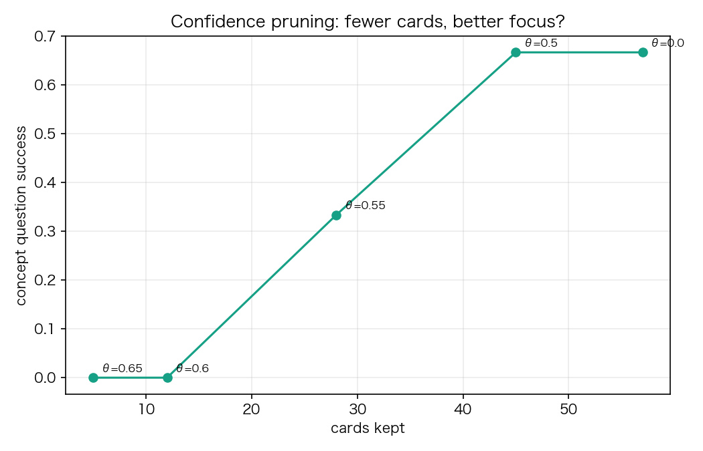

# 网络大脑持续学习实验：知识卡、信念修正与保留

**日期**：2026-11-04  
**代码**：`network_agent/nbpw/continual.py`、`run_continual.py`  
**复现**：

```bash
cd network_agent/nbpw
python3 run_continual.py
```

---

## 0. 摘要

这轮实验验证 NBCL（Network Brain Continual Learner）的最小闭环：

1. **知识获取**：从真实来源抽取知识卡，能否回答“之前不会”的问题；
2. **信念修正**：冲突证据下，append-only 记忆 vs 信念图；
3. **保留/遗忘**：学完新主题后，旧主题是否退化；
4. **巩固/剪枝**：按置信度淘汰低分卡，是否更“精炼”。

结论先行：

- **获取有效，但“知识卡 ≠ 会答题”**：掩码题 0.0→1.0；概念题只有 0.0→0.67。卡片需要综合/重排，不能只做单卡检索。
- **信念修正有效**：12 组冲突对，append-only 0.0，NBCL 1.0。
- **没有灾难性遗忘**：纯记忆追加，旧题 before/after 都是 1.0；代价是存储增长（57 卡/12.9KB）。
- **按置信度剪枝是负结果**：57→45 卡概念题不变（0.67），28 卡降到 0.33，12 卡归零。**低置信但唯一的卡有覆盖价值，不能按置信度粗暴淘汰。**
- 真实来源里检测到的冲突是 **0**：不是没有冲突，而是规则检测器太保守；需要 NLI/claim 对齐。

---

## 1. 实验设置

- 3 个主题：GLP-1 减肥机制、AI agent 评估、Python asyncio 事件循环；
- 每主题 2 个查询，真实来源：PubMed / arXiv / Hacker News / Stack Overflow / OpenAlex / Crossref；
- 共 **30 条来源**，抽取 **57 张知识卡**；
- 12 道掩码题（从卡片挖空关键词）；
- 6 道概念题（通用问法，要求 top-3 卡覆盖至少 2 个关键词）；
- 12 组合成冲突对（同一 claim 加否定，来源信任不同）；
- 单次运行；来源缓存到 `learning_sources.json`，知识卡缓存到 `continual_cards.json`。

### 知识卡

```json
{
  "claim": "...",
  "evidence": "...",
  "source": {"url": "...", "title": "...", "source": "...", "year": "..."},
  "source_type": "PubMed|arXiv|HN|SO|OpenAlex|Crossref",
  "confidence": 0.36-0.75,
  "status": "active|disputed",
  "support": 1
}
```

### 条件

| 条件 | 记忆 |
|---|---|
| static | 只有 starter 项目文档 |
| memory | 全部知识卡（append-only，无冲突处理） |
| nbcl | 去重 + 信念图 active 卡 |

---

## 2. E1：知识获取



| 条件 | 掩码题成功率 | 引用正确率 | 概念题成功率 |
|---|---:|---:|---:|
| static | 0.00 | 0.00 | 0.00 |
| memory | 1.00 | 1.00 | 0.67 |
| nbcl | 1.00 | 1.00 | 0.67 |

### 观察

- 掩码题 1.0：记忆里确实有对应证据，检索能命中；
- 概念题只有 **0.67**：问法更抽象，单卡往往只覆盖 1 个关键词；top-3 聚合后仍不够；
- **这是重要限制**：知识卡是“证据碎片”，不是“可回答的知识”。需要：
  - 查询聚焦的**多卡综合**（LLM/重排/摘要）；
  - 概念级索引（主题→卡集合），而不是纯词面检索；
  - 答案合成后的**引用校验**。

---

## 3. E2：信念修正



12 组合成冲突对（“Drug X increases appetite” vs “Drug X does not increase appetite”，来源信任不同）：

| 条件 | 正确 active 信念 |
|---|---:|
| append-only（先写先赢） | 0.00 |
| NBCL 信念图 | **1.00** |

- 信念图用 `trust + confidence + recency + support` 选出 active，另一张标 `disputed`；
- 关键不是“删除旧卡”，而是**保留来源、标记冲突、可审计**；
- **真实来源中检测到 0 个冲突**：规则检测器要求词面重叠 + 否定差异；很多真实冲突是“不同角度/不同人群/不同剂量”，不是简单否定。需要 NLI/claim 对齐/数值一致性。

---

## 4. E3：保留与遗忘

先学主题 A，评估 A；再学 B/C，回测 A：

| 阶段 | 成功率 | 引用 |
|---|---:|---:|
| 学 A 后 | 1.00 | 1.00 |
| 学 B/C 后 | 1.00 | 1.00 |

- **纯记忆追加没有灾难性遗忘**；这是 memory-based continual learning 的优势；
- 代价转移到**存储/检索精度/验证成本**，不是权重退化；
- 这也说明：如果只做 L1 记忆，不需要“反向传播”，但需要“检索/综合/淘汰”。

---

## 5. E4：置信度剪枝（负结果）



| 置信度阈值 | 保留卡数 | 概念题 | 掩码题 |
|---:|---:|---:|---:|
| 0.00 | 57 | 0.67 | 1.00 |
| 0.50 | 45 | 0.67 | 0.83 |
| 0.55 | 28 | 0.33 | 0.67 |
| 0.60 | 12 | 0.00 | 0.50 |
| 0.65 | 5 | 0.00 | 0.33 |

- **按置信度剪枝会伤害覆盖**：低置信但唯一的卡仍然有用；
- 57→45 卡概念题不变，但掩码题下降；28 卡开始崩；
- 结论：**不要按单一置信度淘汰**；要用**覆盖/独特性/效用**：
  - 保留“唯一覆盖某主题/关系”的卡；
  - 优先淘汰重复/近重复；
  - 用 held-out 题做效用评估；
  - 置信度只做排序，不做硬阈值。

---

## 6. 成本

| 指标 | 数值 |
|---|---:|
| 来源 | 30 |
| 知识卡 | 57 |
| 去重后 | 57（本轮近重复少） |
| 冲突/争议 | 0（规则检测） |
| 卡片字节 | 12,922 |
| 首次抓取+抽取 | ~32s |
| 缓存后重跑 | <1s |

- 抓取/验证是主要成本；
- 57 卡/12.9KB 很小，但真实 7 天实验会到数千卡，需要索引/剪枝/分片。

---

## 7. 详细分析

### 7.1 “知识卡 ≠ 会答题”

掩码题是词面检索，1.0 很正常；概念题要求跨卡综合，只有 0.67。  
这说明 NBCL 的最小闭环不能停在“存卡”，必须加：

1. **查询聚焦重排**（cross-encoder/LLM rerank）；
2. **多卡摘要**（把 3–5 张卡合成答案）；
3. **概念索引**（topic/relation/entity）；
4. **引用校验**（答案句必须能回到卡/来源）。

### 7.2 信念修正的价值在“可审计”，不只是准确率

append-only 0.0 是极端基线，但它说明：没有冲突处理，记忆会“自相矛盾”。  
信念图的价值：

- 保留双方来源；
- 标 `disputed`；
- 用信任/时间/支持度选 active；
- 可回滚、可解释。

真实冲突检测需要 NLI/claim 对齐，规则检测不够。

### 7.3 没有灾难性遗忘，但有“记忆膨胀”

纯记忆追加不会忘，但会：

- 存储增长；
- 检索噪声；
- 重复/矛盾卡增多；
- 综合成本上升。

所以 NBCL 的“遗忘”不是权重遗忘，而是**记忆淘汰**；淘汰标准不能是单一置信度。

### 7.4 置信度校准很差

本轮置信度范围 0.36–0.75，且与“是否覆盖问题”弱相关；按阈值剪枝直接崩。  
需要：

- 用 held-out 题校准；
- 用来源类型/多源一致性/时间做校准；
- 保留“低置信但唯一”的卡；
- 置信度只做排序/提示，不做硬删。

---

## 8. 设计修订

基于结果，NBCL 设计做以下修改：

1. **知识卡 → 证据卡 + 概念卡**：
   - 证据卡：原文句 + 来源；
   - 概念卡：由多张证据卡综合，带引用；
2. **检索 → 多卡重排 + 综合**，不是 top-1；
3. **信念图**保留 disputed/superseded，不删除；
4. **冲突检测**升级为 NLI + 数值/时间/人群/剂量对齐；
5. **剪枝**改为覆盖/独特性/效用，不用置信度硬阈值；
6. **评估**加概念题/held-out/人工抽检，不只掩码题；
7. **成本**把抓取/验证/综合分开计量。

---

## 9. 与 OpenNetAgent 的集成

- `knowledge_cards` 表：claim、evidence、source_type、confidence、status、supports/contradicts；
- `/learn`：一次学习循环（抓取→抽卡→验证→写图→出题→评估）；
- 定时器：每日/每周；
- NLI 节点：冲突验证；
- `/knowledge_pack`：证据卡 + 概念卡摘要；
- UI：Learning feed（今天学到什么、哪些有冲突、哪些被淘汰）；
- 节点：source/verifier/memory 即可，不要求模型/token。

---

## 10. 下一轮实验

1. 7 天连续学习（3 主题，每天 20 查询）；
2. 真实 NLI 做冲突检测，建 50 组人工冲突集；
3. 概念题 + held-out + 人工评分；
4. 多卡综合（LLM/重排）前后对比；
5. 覆盖/效用剪枝 vs 置信度剪枝；
6. 记忆规模到 1k/10k 卡的检索/成本曲线。

---

## 11. 结论

- **获取可行**：真实来源→知识卡，静态 0→1.0（掩码）；
- **可用性不足**：概念题只有 0.67，必须加综合/重排/概念索引；
- **信念修正有效**：冲突对 0→1.0，但真实冲突检测仍是瓶颈；
- **无灾难遗忘**：记忆追加保留旧知识，代价是膨胀；
- **剪枝是负结果**：不能按置信度硬删，低置信唯一卡有覆盖价值。

一句话：**NBCL 的第一条工程规律是：先保证“可追溯的证据”，再谈“综合成知识”；先保证“覆盖”，再谈“精简”。**
